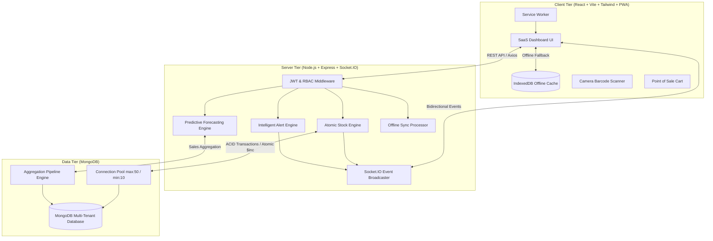

# SmartStock – Intelligent Inventory Management System (MERN Stack)

[](https://react.dev/)
[](https://nodejs.org/)
[](https://www.mongodb.com/)
[](https://vitejs.dev/)
[](https://tailwindcss.com/)
[](LICENSE)

**SmartStock** is a commercial-grade, multi-tenant Smart Inventory Management System engineered for modern small businesses and high-throughput retail operations. Built strictly using the **MERN** architecture (MongoDB, Express.js, React+Vite, Node.js), SmartStock combines **real-time Socket.IO inventory updates**, **predictive restocking analytics**, **optical camera barcode scanning**, **role-based access control (RBAC)**, and **offline-first PWA resilience**.

---

## 1. System Architecture



---

## 2. Technology Stack

### Frontend
- **React 18** with **Vite** for ultra-fast HMR and production tree-shaking
- **Tailwind CSS** with full dark-mode support and modern enterprise styling
- **Lucide React** for consistent, clean iconography
- **Recharts** for interactive Area, Donut, and Bar charts
- **React Router DOM v6** for client-side routing and protected routes
- **Axios** with request/response interceptors and automated offline caching
- **React Context API** (`AuthContext`, `SocketContext`, `ThemeContext`, `OfflineContext`)
- **html5-qrcode** for camera-based barcode scanning (EAN-13, EAN-8, UPC-A, UPC-E, Code 128)
- **IndexedDB (`idb`)** for offline catalog caching and pending transaction queue
- **Service Workers & Web App Manifest** for Progressive Web Application (PWA) offline execution

### Backend
- **Node.js** (v18+) & **Express.js** REST API
- **JWT (JSON Web Tokens)** & **bcryptjs** (12 salt rounds)
- **Socket.IO** for real-time inventory updates and stockout notifications
- **Helmet**, **CORS**, and **express-rate-limit** for comprehensive API protection
- **Morgan** and structured JSON logger for observability

### Database
- **MongoDB** with **Mongoose ODM**
- **MongoDB Aggregation Pipelines** for high-performance demand forecasting
- **MongoDB Compound & Sparse Indexes** for sub-millisecond lookups
- **ACID Transactions** with automated detection for Replica Sets and safe atomic fallback for standalone instances
- **100,000 Product Ceiling Enforcement** verified concurrently on the server

---

## 3. Quick Start & Setup

### Prerequisites
- Node.js >= 18.0.0
- MongoDB instance running locally on `mongodb://localhost:27017` or MongoDB Atlas URI

### Installation

```bash
# 1. Clone or navigate to the repository
cd smartstock

# 2. Install dependencies for all workspaces (root, server, and client)
npm install

# 3. Configure environment variables (or copy .env.example)
cp .env.example server/.env

# 4. Seed the database with demo business, products, and 60 days of sales history
npm run seed

# 5. Start both Backend and Frontend concurrently
npm run dev
```

### URLs
- **Frontend Dashboard**: [http://localhost:5173](http://localhost:5173)
- **Backend API**: [http://localhost:5000](http://localhost:5000)
- **API Health Check**: [http://localhost:5000/health](http://localhost:5000/health)

---

## 4. Default Demo Accounts

The database seeder automatically initializes a complete multi-tenant dataset:

| Role | Email Address | Password | Permissions |
| :--- | :--- | :--- | :--- |
| **ADMIN** | `admin@smartstock.io` | `Password123!` | Full CRUD, predictions, staff management, settings, export/import |
| **STAFF** | `staff@smartstock.io` | `Password123!` | POS Sales, stock-in intake, inventory lookup, barcode scanning |

---

## 5. Core Feature Specifications

### A. Predictive Restocking & Demand Forecasting
The predictive engine analyzes historical sales data across a rolling lookback window (30 to 60 days) using an optimized MongoDB Aggregation Pipeline:

$$\text{Average Daily Demand} = \frac{\text{Total Units Sold in Window}}{\text{Number of Days}}$$

$$\text{Safety Stock} = \max\left(\lceil \text{Average Daily Demand} \times 3 \rceil, \lceil \sigma \times \sqrt{\text{Lead Time}} \rceil, 5\right)$$

$$\text{Reorder Point} = (\text{Average Daily Demand} \times \text{Supplier Lead Time}) + \text{Safety Stock}$$

$$\text{Suggested Restock Quantity} = \max\left(0, \text{Target Stock Level} - \text{Current Stock}\right)$$

$$\text{Predicted Stockout Days} = \frac{\text{Current Stock}}{\text{Average Daily Demand}}$$

- Automatically flags **CRITICAL** urgency if predicted stockout date arrives before the supplier's order lead time.
- Calculates dynamic confidence metrics based on daily sales variance and sample regularity.
- Gracefully handles insufficient historical data without fabricating predictions.

### B. Barcode Scanning
- Uses camera feed from laptops, webcams, or mobile cameras.
- Supports EAN-13, EAN-8, UPC-A, UPC-E, and Code 128.
- Produces acoustic feedback on detection and performs an instant `/api/barcode/:code` lookup.
- If a barcode is unregistered, provides an immediate 1-click modal to register the new product with the barcode prefilled.

### C. Offline-First Architecture & Resilient PWA
- **Service Worker** caches application shell and static assets.
- **IndexedDB** stores product catalog locally for offline browsing and offline POS checkout.
- While offline, transactions and stock-in requests are queued with unique UUID idempotency keys.
- When network connectivity resumes, the client automatically synchronizes queued records to `/api/sync/batch`.
- Server validates real-time stock levels, detects concurrency conflicts, and commits valid transactions without overwriting newer data.

### D. Multi-Tenant Isolation & 100K Item Constraint
- Strict business-level isolation: every collection queries `{ businessId: req.user.businessId }`.
- Compound unique indexes prevent duplicate SKU or Barcode conflicts within the same business.
- Enforces a 100,000 product catalog ceiling per business on the server side before execution.

---

## 6. Complete REST API Reference

### Authentication & Business
| Method | Endpoint | Access | Description |
| :--- | :--- | :--- | :--- |
| `POST` | `/api/auth/register` | Public | Register new business & admin user |
| `POST` | `/api/auth/login` | Public | User login, returns JWT and user payload |
| `POST` | `/api/auth/logout` | Authenticated | Invalidate session |
| `GET` | `/api/auth/me` | Authenticated | Retrieve authenticated user & business profile |
| `PUT` | `/api/auth/settings` | Admin | Update business settings, currency, and tax rate |

### Products & Inventory
| Method | Endpoint | Access | Description |
| :--- | :--- | :--- | :--- |
| `GET` | `/api/products` | All | Paginated product list with search and filters |
| `POST` | `/api/products` | Admin | Create product (enforces 100k item limit) |
| `GET` | `/api/products/:id` | All | Get product details and recent stock movements |
| `PUT` | `/api/products/:id` | Admin | Update product specifications and prices |
| `DELETE` | `/api/products/:id` | Admin | Soft delete / archive product |
| `GET` | `/api/products/export/csv`| Admin | Export entire inventory to CSV |
| `POST` | `/api/products/import/csv`| Admin | Bulk import products from CSV content |

### Stock Movements
| Method | Endpoint | Access | Description |
| :--- | :--- | :--- | :--- |
| `POST` | `/api/stock/in` | All | Record stock intake / supplier arrival |
| `POST` | `/api/stock/out` | Admin | Deduct damaged, expired, or returned stock |
| `POST` | `/api/stock/adjust` | Admin | Manual physical inventory audit set |
| `GET` | `/api/stock/movements` | All | Paginated inventory movement audit trail |

### Barcode & Sales
| Method | Endpoint | Access | Description |
| :--- | :--- | :--- | :--- |
| `GET` | `/api/barcode/:code` | All | Fast lookup by barcode or SKU |
| `POST` | `/api/sales` | All | Record sale with atomic stock deduction |
| `GET` | `/api/sales` | All | Paginated sales ledger |
| `GET` | `/api/sales/:id` | All | Get detailed receipt by transaction ID |

### Alerts & Predictions
| Method | Endpoint | Access | Description |
| :--- | :--- | :--- | :--- |
| `GET` | `/api/alerts` | All | Active threshold alerts |
| `PUT` | `/api/alerts/:id/read` | All | Mark alert as read |
| `PUT` | `/api/alerts/:id/dismiss` | All | Dismiss alert |
| `PUT` | `/api/alerts/mark-all-read` | All | Bulk mark all alerts as read |
| `GET` | `/api/predictions` | Admin | Predictive restock recommendations |
| `POST` | `/api/predictions/recalculate`| Admin | Recalculate forecasting models |
| `GET` | `/api/predictions/:productId`| Admin | Single product demand prediction |

### Dashboard, Suppliers, Staff & Offline Sync
| Method | Endpoint | Access | Description |
| :--- | :--- | :--- | :--- |
| `GET` | `/api/dashboard/summary` | All | 6 KPI cards summary |
| `GET` | `/api/dashboard/sales` | All | Revenue trends & best sellers |
| `GET` | `/api/dashboard/inventory` | All | Category breakdown & stock health |
| `GET` | `/api/dashboard/activity` | All | Live inventory movements feed |
| `GET` | `/api/suppliers` | All | List suppliers |
| `POST` | `/api/suppliers` | Admin | Add supplier with lead time |
| `GET` | `/api/staff` | Admin | List business staff |
| `POST` | `/api/staff` | Admin | Create staff account |
| `POST` | `/api/sync/batch` | All | Synchronize offline transaction queue |
| `GET` | `/api/sync/status` | All | Offline sync status telemetry |

---

## 7. Scalability Architecture: Target 1 Million Daily Transactions

### Throughput Calculations
- **1,000,000 Transactions / 24 Hours**:
  - Baseline: $\approx 11.5$ transactions per second.
  - Peak Trading Hours (e.g. 4x multiplier): $\approx 45 - 120$ transactions per second.
  - Query Read/Write Ratio: $\approx 85\%$ reads (catalog browsing, dashboard telemetry, barcode lookups), $15\%$ writes (sales checkout, stock intake).

### High-Scale Architectural Decisions
1. **Connection Pooling**: Configured with `maxPoolSize: 50` and `minPoolSize: 10` per Node process to eliminate TCP handshake latency.
2. **Atomic Conditionals instead of Heavy Row Locks**: Stock deductions utilize atomic MongoDB operations:
   ```javascript
   Product.findOneAndUpdate(
     { _id: productId, businessId, currentStock: { $gte: quantity } },
     { $inc: { currentStock: -quantity } },
     { new: true }
   );
   ```
   This prevents race conditions and negative inventory levels without holding locks across multiple HTTP requests.
3. **Compound & Text Indexing**: Queries utilize `{ businessId: 1, isArchived: 1, currentStock: 1 }` and full-text indexes so queries scan indexes in memory rather than collection scanning.
4. **Asynchronous Prediction Calculations**: Daily demand and restocking metrics run via scheduled cron or on-demand background calculations, never in line with synchronous point-of-sale checkout calls.
5. **Horizontal Application Scaling**: The Express backend is stateless, relying on JWT claims and Redis/in-memory caches, allowing multiple Node.js instances behind an Nginx or AWS ALB reverse proxy.

### Running Load Tests
A k6 load test script is included in `server/tests/k6-load-test.js`:

```bash
# Install k6 (if not already installed: https://k6.io/)
# Run load test simulation targeting 100 concurrent virtual users
k6 run server/tests/k6-load-test.js
```

---

## 8. Automated Testing

Run the integration and unit test suite:

```bash
cd server
npm test
```

Tests cover:
- Business registration & Admin account initialization
- Role-based access control (Admin vs Staff)
- Product CRUD and duplicate SKU prevention
- 100,000 product limit enforcement
- Atomic stock deductions and negative stock rejection
- Barcode lookup and threshold alert generation
- Dashboard KPI calculations

---

## 9. License

This project is licensed under the MIT License. Built with the MERN Stack.
